# AiSdlc

AI-assisted software development lifecycle: AI drafts requirements analysis, architecture, development tasks and QA test cases; named reviewers approve each stage. Portfolio project; all data is synthetic.

<!-- Replace <owner>/<repo> with the GitHub path once the remote exists. -->
[](https://github.com/<owner>/<repo>/actions/workflows/ci.yml)


## What it does
- Upload a requirements document (`.docx` or `.txt`) and a team sheet (`.xlsx` with name, role, skills, capacity, availability); files are validated, hashed and versioned.
- AI analyses the requirements, drafts an architecture plan, breaks it into development tasks and generates QA test cases.
- Four human review gates (analysis, architecture, tasks, test cases) with role-based approval; reviewers can regenerate any output with written feedback.
- Tasks are scheduled across sprints (2, 3 or 4 weeks, default 2; 8 working hours a day) and spill into later sprints until everything is assigned; the team page shows each member's utilisation as a progress bar.
- Full audit trail of uploads, AI calls, decisions and edits.

See [docs/spec.md](docs/spec.md) for roles, gates and rules.

## Architecture



| Diagram | What it shows |
| --- | --- |
| [Containers](docs/diagrams/containers.svg) | Web app, API, SQLite, file storage and the AI model |

Services and layers are described in [docs/architecture.md](docs/architecture.md). Key decisions are recorded in [docs/adr](docs/adr).

## Tech stack
.NET 10 · ASP.NET Core Minimal APIs · EF Core · SQLite · ASP.NET Core Identity + JWT · Angular · Microsoft.Extensions.AI with OpenAI · Aspire · OpenTelemetry

## Run it locally

No Docker and no database server are needed: the database is SQLite and uploaded files are stored on local disk.

### Prerequisites
| Tool | Version | Check with |
| --- | --- | --- |
| .NET SDK | 10.x | `dotnet --version` |
| Node.js | 22 or newer | `node --version` |
| Aspire CLI (optional, for `aspire run`) | latest | `aspire --version` (install: `dotnet tool install --global Aspire.Cli`) |

### 1. Clone and install the web packages (once)
```bash
git clone https://github.com/sushovan-code/Ai-Sdlc.git
cd Ai-Sdlc
cd src/web/aisdlc-web
npm install
cd ../../..
```

### 2. Secrets
The app runs fully offline now. The AI features arrive in later slices and will need an OpenAI key, set as a user secret from your own terminal (never committed, never pasted into chat or a config file):
```bash
dotnet user-secrets --project src/AiSdlc.AppHost set "Parameters:openai-api-key" "<your key>"
```
| Secret | Needed for | Where to get it |
| --- | --- | --- |
| `Parameters:openai-api-key` | AI text generation (model `gpt-5.4-mini`) | OpenAI platform, API keys |

### 3. Run it, option A: with Aspire (one command)
From the repository root:
```bash
dotnet run --project src/AiSdlc.AppHost --launch-profile https
```
or, if the Aspire CLI is installed, `aspire run`.

This starts the API and the Angular app together and prints a link to the Aspire dashboard (logs, traces and resource status). Open **http://localhost:4200**. Press **Ctrl+C** to stop everything.

> Use the `https` launch profile. The `http` profile makes Aspire refuse to start unless `ASPIRE_ALLOW_UNSECURED_TRANSPORT=true` is set.

### 3. Run it, option B: standalone (two terminals)
Start the API first, then the web app.

Terminal 1, API (listens on http://localhost:5073):
```bash
dotnet run --project src/AiSdlc.Api --launch-profile http
```

Terminal 2, web app:
```bash
cd src/web/aisdlc-web
npm start
```
Open **http://localhost:4200**. The dev server forwards `/api` to http://localhost:5073 (see `src/web/aisdlc-web/proxy.conf.js`), so there is nothing to configure. Stop each terminal with **Ctrl+C**.

### Where things are
| What | URL or path |
| --- | --- |
| Web app | <http://localhost:4200> |
| API | <http://localhost:5073> (Aspire may assign its own port; the dashboard shows it) |
| API description (OpenAPI, Development only) | <http://localhost:5073/openapi/v1.json> |
| Aspire dashboard (option A only) | printed in the console |
| Database and uploaded files | `src/AiSdlc.Api/App_Data/` (delete this folder for a clean start) |

### 4. Sign in with a test user
Seeded in Development only (local data, not real credentials). All five share one password:

| User | Password | Role |
| --- | --- | --- |
| `pm@demo.local` | `Demo#Passw0rd!` | Project Manager |
| `architect@demo.local` | `Demo#Passw0rd!` | Architect |
| `dev@demo.local` | `Demo#Passw0rd!` | Developer |
| `qa@demo.local` | `Demo#Passw0rd!` | QA |
| `admin@demo.local` | `Demo#Passw0rd!` | Administrator (manages users and roles) |

You can also create an account on the sign-in page. New accounts start as Developers; sign in as the administrator and open **Users** to change a role.

### 5. Try it
1. Sign in as `pm@demo.local`, enter a project name and select **Create project**. A notification confirms each action in the top-right corner.
2. On **Files & team**, upload a requirements file (`.docx` or `.txt`) and a team sheet (`.xlsx`). Uploading again adds a new version.
3. Under **Team**, pick people from the suggestions (or filter by name) and select **Add**. Only people added to a project can see it.
4. Use **Next** and **Previous** (or the stepper) to move between stages. **Next** stays disabled, with the reason shown beside it, until the stage is complete and the review gate that closes it is approved by the right role.
5. Sign out and sign in as `architect@demo.local`: the project is visible, files can be downloaded but not uploaded or deleted. Sign in as `qa@demo.local` (not added): the project is not listed, and opening its URL shows "Project not found".

Files are checked for type, size (10 MB), signature and structure; macro-enabled files and mismatched content are rejected.

### The team sheet
The team template is an `.xlsx` whose first sheet has these columns (in any order, headers can sit below a title):

| Name | Role | Skills | Capacity | Availability |
| --- | --- | --- | --- | --- |
| Asha Rao | Developer | C#, ASP.NET Core, SQL, EF Core | 40 | 30 |
| Meera Iyer | QA | Testing, Selenium, API Testing | 40 | 40 |

- **Capacity** and **Availability** are hours for a **2-week window**. Availability cannot exceed Capacity, and Capacity cannot exceed 80 hours (10 working days of 8 hours).
- Skills are separated by commas or semicolons. Each person must be listed once.
- A sheet with any bad row is refused as a whole, and the message names every problem by row so it can be fixed in one go.
- The **sprint length** is set per project: 2 weeks (default), 3 or 4. A person's hours per sprint are their Availability × (weeks ÷ 2). Work that does not fit in the first sprint spills into the next until everything is assigned.
- People on the sheet are capacity to plan with, not login accounts. The **Team capacity and sprints** panel shows each person's booked hours against capacity as a progress bar (nothing is booked until tasks are scheduled in a later release).

### 6. Run the tests
```bash
dotnet test
cd src/web/aisdlc-web
npm run test:ci
npm run lint
```

### Troubleshooting
- **Port 4200 or 5073 is busy**: another copy is still running. Stop it (Ctrl+C in its terminal) and start again.
- **Aspire says the `applicationUrl` must be https**: you used the `http` profile. Use `--launch-profile https`.
- **HTTPS certificate warning**: run `dotnet dev-certs https --trust` once.
- **Sign-in says "Cannot reach the server"**: the API is not running (option B) or is still starting; wait a few seconds.
- **Regenerate the typed API client** after changing endpoints: start the API, then `npm run api:types --prefix src/web/aisdlc-web`.
- **Start with clean data**: stop the app and delete `src/AiSdlc.Api/App_Data/`.

## Deploy (optional)
See [docs/deploy.md](docs/deploy.md) once it exists. Deployment is manual and isn't needed to run or review the code.

## Licence
MIT
